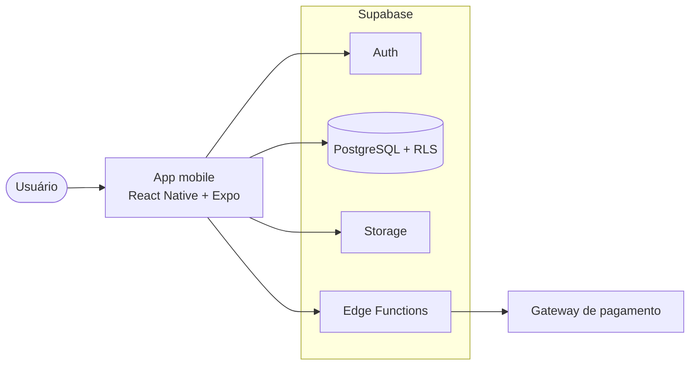
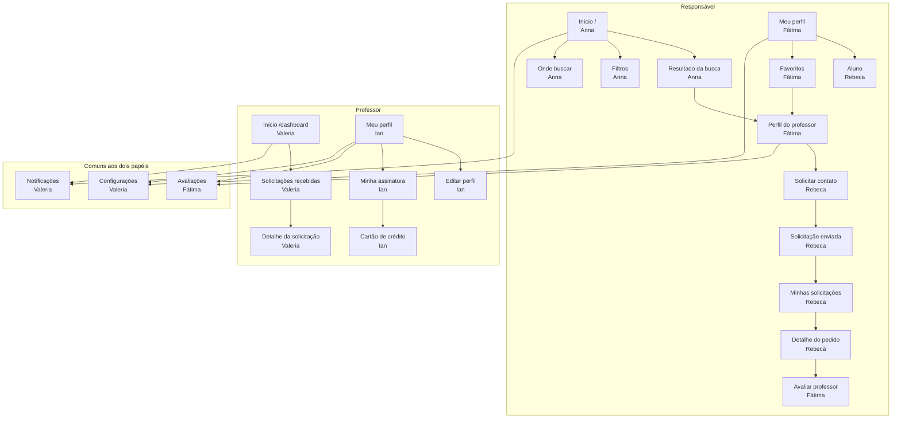

# Destrava

**Conectando professores de reforço escolar a pais próximos.**

> **Status:** MVP em desenvolvimento. Este repositório reúne o **aplicativo mobile** e o **backend no Supabase** do Destrava, além da documentação de planejamento ([apresentação](DESTRAVA.pdf) e [Business Model Canvas](DESTRAVA.png)). O app já tem cadastro, login e o onboarding de responsáveis e professores, e o banco tem o schema de todas as funcionalidades do MVP. As demais telas já existem como rotas provisórias, com a navegação funcionando e o nome de quem vai desenvolver cada uma (veja [Divisão das telas do MVP](#divisão-das-telas-do-mvp)).

## O que é

O Destrava é um aplicativo que aproxima pais que procuram reforço escolar para os filhos de professores particulares que atuam na mesma região. O pai encontra professores perto de casa, compara perfis e avaliações e pede contato pela plataforma. O professor ganha uma vitrine para divulgar seu trabalho e chegar a novos alunos.

## O problema

- **Para os pais:** é difícil encontrar um professor de reforço confiável e que more perto. A busca costuma depender de indicação boca a boca, sem como checar quem é a pessoa nem como ela trabalha.
- **Para os professores:** quem dá aula particular por conta própria tem dificuldade de se divulgar e de encontrar alunos na própria região.

## A proposta

O Destrava junta os dois lados numa plataforma só, com foco em **confiança e controle**:

- **Professores com identidade verificada**, por envio de documento no cadastro.
- **Busca por cidade e estado**, com filtros por matéria, idioma, valor e tipo de reforço.
- **Avaliações por estrelas**, com comentário opcional, deixadas por pais que já tiveram aula com o professor.
- **Contato mediado:** o pai envia uma solicitação e o professor decide se aceita ou recusa. Só depois do aceite os dois passam a ver o WhatsApp um do outro e o link da rede social do professor aparece. Isso dá mais privacidade e segurança aos dois lados. A conversa acontece no WhatsApp; não há chat dentro do app.

## Para quem é

- **Pais e responsáveis** por alunos do ensino fundamental e médio que buscam reforço escolar.
- **Professores particulares autônomos** que querem divulgar seus serviços e encontrar alunos na região.

## Como funciona

1. Pai ou professor **cria uma conta e faz login** — a primeira tela do app é o cadastro (escolha entre pai ou professor), com acesso ao login para quem já tem conta; não há navegação sem cadastro.
2. O pai **busca professores na sua cidade e estado** e vê nome, matérias, valor da hora e avaliações.
3. O pai envia uma **solicitação de contato** por formulário, com seus dados, os dados do filho e o motivo do reforço.
4. O professor recebe a solicitação e **aceita ou recusa** em até 24 horas. Sem resposta, a solicitação expira e o pai pode pedir de novo.
5. Com o aceite, cada um ganha um **botão para abrir o WhatsApp** do outro e o **link da rede social** do professor passa a ficar visível para aquele pai.
6. Depois da aula, o pai **avalia** o professor com uma nota (obrigatória) e um comentário (opcional).

## Requisitos funcionais

| Código | O sistema deve                                                                                                                                                                                                                                              |
| ------ | ----------------------------------------------------------------------------------------------------------------------------------------------------------------------------------------------------------------------------------------------------------- |
| RF01   | Permitir que professores criem uma conta e um perfil completo: dados pessoais, formação (opcional), matérias, idiomas, disponibilidade, tipo de reforço e valor da hora.                                                                                    |
| RF02   | Permitir a verificação de identidade do professor por envio de documento no cadastro.                                                                                                                                                                       |
| RF03   | Exigir cadastro e login para usar o app (pai ou professor); a primeira tela é o cadastro, com acesso ao login, sem navegação anônima. O usuário autenticado vê o perfil dos professores (nome, matérias, valor e avaliações), exceto o link de rede social. |
| RF04   | Permitir a busca de professores por localização, filtrando por cidade e estado (sem cálculo de raio geográfico).                                                                                                                                            |
| RF05   | Permitir filtrar professores por matéria, idioma, valor e tipo de reforço.                                                                                                                                                                                  |
| RF06   | Exibir no perfil do professor a nota média e a quantidade total de avaliações recebidas.                                                                                                                                                                    |
| RF07   | Permitir que o pai solicite contato com um professor por formulário (dados do responsável, do filho e motivo do reforço).                                                                                                                                   |
| RF08   | Permitir que o professor aceite ou recuse uma solicitação de contato recebida.                                                                                                                                                                              |
| RF09   | Liberar o número de WhatsApp de cada lado para o outro somente após o professor aceitar a solicitação; antes do aceite nenhum dos dois vê o número.                                                                                                         |
| RF10   | Exibir, após o aceite, um botão "Conversar no WhatsApp" que abre a conversa por link `wa.me` com mensagem inicial pré-preenchida; o app não tem chat próprio.                                                                                               |
| RF11   | Liberar o link de rede social do professor somente após o aceite da solicitação.                                                                                                                                                                            |
| RF12   | Permitir que o pai avalie o professor com nota (obrigatória) e comentário (opcional) após a aula.                                                                                                                                                           |
| RF13   | Processar a cobrança da assinatura do professor, incluindo o controle do período de teste gratuito.                                                                                                                                                         |
| RF14   | Exibir para o pai a lista "Minhas solicitações", com o status de cada uma (pendente, aceita, recusada ou expirada) e o botão do WhatsApp nas aceitas.                                                                                                       |
| RF15   | Exibir para o professor a lista "Solicitações recebidas", com aceitar e recusar nas pendentes e o botão do WhatsApp nas aceitas.                                                                                                                            |

> **Mudanças em relação à apresentação:** o chat interno previsto originalmente (RF09, RF10, RF14 e RF15) foi substituído por um botão que abre o WhatsApp, liberado só depois do aceite. A mudança reduz o escopo do MVP (sem mensageria própria, moderação de conteúdo ou armazenamento de conversas) e mantém o número de telefone protegido até o professor aceitar, o que dá mais privacidade a famílias e professores. Por isso o Supabase Realtime também saiu da arquitetura. No MVP, a cobrança da assinatura (RF13) e a verificação de identidade (RF02) são **simuladas**: o fluxo funciona de ponta a ponta (teste grátis, cobrança mensal, cancelamento, aprovação do cadastro), mas nenhum pagamento real acontece e o documento é aprovado no envio. Também passaram a valer duas decisões posteriores da equipe: o **cadastro é obrigatório** — a primeira tela é o cadastro, com acesso ao login, e não há navegação anônima (RF03) — e a **busca por proximidade passou a ser por cidade e estado**, não por raio geográfico (RF04), o que removeu PostGIS, o Google Maps e a permissão de localização da arquitetura.

## Requisitos não funcionais

| Código | O sistema deve                                                                     |
| ------ | ---------------------------------------------------------------------------------- |
| RNF01  | Responder às buscas em até 2 segundos.                                             |
| RNF02  | Garantir autenticação segura (senha criptografada e token).                        |
| RNF03  | Estar em conformidade com a LGPD.                                                  |
| RNF04  | Ser compatível com Android 8+ e iOS 13+.                                           |
| RNF05  | Garantir disponibilidade (uptime) de pelo menos 99%.                               |
| RNF06  | Permitir login e cadastro com conta Google (OAuth), além de e-mail e senha.        |
| RNF07  | Solicitar apenas as permissões estritamente necessárias, sempre com justificativa. |
| RNF08  | Ter tamanho de instalação inferior a 100 MB.                                       |
| RNF09  | Armazenar os dados com backup automático periódico.                                |
| RNF10  | Limitar o cache local a 200 MB, com opção de limpeza.                              |

## Arquitetura

O app mobile consome diretamente os serviços do Supabase, sem um backend próprio. As regras de negócio que não podem depender do app (aceite e recusa, liberação do WhatsApp e da rede social, controle de assinatura) ficam no próprio banco, em políticas de RLS (Row Level Security), triggers e funções. Edge Functions ficam para as integrações externas, como o gateway de pagamento quando ele for escolhido.



| Componente                     | Função                                                                                                                                |
| ------------------------------ | ------------------------------------------------------------------------------------------------------------------------------------- |
| App mobile                     | Interface do usuário; consome diretamente os serviços do Supabase (auth, banco e storage).                                            |
| Supabase Auth                  | Autenticação de pais e professores, incluindo login com Google OAuth.                                                                 |
| Supabase Database (PostgreSQL) | Dados estruturados: perfis, solicitações de contato, avaliações e assinaturas. A busca filtra por cidade e estado (campos do perfil). |
| Supabase Storage               | Fotos de perfil (bucket público) e documentos de verificação dos professores (bucket privado).                                        |
| RLS, triggers e funções        | Regras de negócio: aceite e recusa, liberação do WhatsApp e da rede social, busca por cidade/estado e assinatura.                     |
| Edge Functions                 | Integrações externas (gateway de pagamento, quando houver).                                                                           |
| APIs externas                  | WhatsApp (abertura da conversa por link) e gateway de pagamento.                                                                      |

### Stack

| Camada                    | Tecnologia                                  |
| ------------------------- | ------------------------------------------- |
| Frontend mobile           | React Native com Expo (SDK 58) e TypeScript |
| Navegação                 | Expo Router                                 |
| Dados e formulários       | TanStack Query, react-hook-form e zod       |
| BaaS                      | Supabase                                    |
| Banco de dados            | PostgreSQL (via Supabase)                   |
| Autenticação              | Supabase Auth                               |
| Jobs agendados            | pg_cron                                     |
| Armazenamento de arquivos | Supabase Storage                            |
| Infraestrutura            | Gerenciada pelo Supabase                    |

### Padrões de arquitetura

| Camada                | Padrão                                                  |
| --------------------- | ------------------------------------------------------- |
| Mobile                | MVVM (Model-View-ViewModel) com organização por feature |
| BaaS / Edge Functions | Organização por domínio de negócio                      |

Como o app fala direto com o Supabase, a Clean Architecture é aplicada dentro do próprio app: as regras de negócio (liberar WhatsApp e rede social só após o aceite) ficam isoladas das chamadas ao SDK do Supabase. Se o grupo trocar de provedor de BaaS no futuro, só a camada de integração precisa ser reescrita.

No MVP essa separação é aplicada de forma simplificada: cada feature concentra as chamadas ao Supabase num arquivo `api.ts`, os hooks da feature fazem o papel de ViewModel e as telas só renderizam.

### Implantação

O Destrava roda em nuvem, sobre o Supabase:

- **Sem infraestrutura própria:** não há servidores físicos nem backend dedicado para manter.
- **Custo inicial reduzido:** a camada gratuita do Supabase cobre as primeiras fases do produto.
- **Escalabilidade automática:** a infraestrutura acompanha o crescimento da base de usuários sem intervenção manual.

## Modelo de negócio


- **Receita:** assinatura mensal cobrada dos professores, com valor acessível e período de teste gratuito. Como evolução, está previsto um modelo freemium, com recursos pagos como maior destaque nos resultados de busca.
- **Canais:** Instagram, landing page otimizada para SEO, Play Store e App Store, parcerias com escolas e indicação boca a boca entre pais, alunos e professores.
- **Parcerias principais:** escolas (divulgação), gateway de pagamento, serviço de verificação de documentos e Supabase.
- **Custos:** desenvolvimento e manutenção do app, infraestrutura (Supabase), APIs de terceiros (verificação de identidade e pagamentos), marketing e aquisição de usuários, suporte, moderação e conformidade com a LGPD.

## Desenvolvimento

O repositório é um monorepo com npm workspaces: o app e o projeto Supabase (migrações, configuração e Edge Functions) são versionados juntos. O que cada pasta faz está em [Organização do projeto](#organização-do-projeto).

```
apps/mobile/   # app Expo (React Native + TypeScript)
supabase/      # config.toml, migrations/, functions/, seed.sql
```

### Pré-requisitos

- Node.js 24 (versão em `.nvmrc`)
- [Docker Desktop](https://www.docker.com/products/docker-desktop/) rodando, para o Supabase local
- O app **Expo Go** no celular, ou o navegador para a versão web

A Supabase CLI já vem como dependência do projeto; não precisa instalar à parte.

### Primeira execução

1. Instale as dependências na raiz:

   ```bash
   npm install
   ```

2. Suba o Supabase local. Na primeira vez ele baixa as imagens Docker, o que demora alguns minutos:

   ```bash
   npm run db:start
   ```

3. Crie o arquivo de ambiente do app a partir do modelo:

   ```bash
   cp apps/mobile/.env.example apps/mobile/.env
   ```

   Preencha `EXPO_PUBLIC_SUPABASE_PUBLISHABLE_KEY` com a chave "Publishable" mostrada por `npm run db:status`. Para abrir o app no celular, troque `127.0.0.1` em `EXPO_PUBLIC_SUPABASE_URL` pelo IP da sua máquina na rede Wi-Fi (o celular não enxerga o `127.0.0.1` do computador).

4. Inicie o app e leia o QR code com o Expo Go (ou aperte `w` para abrir no navegador):

   ```bash
   npm run mobile
   ```

O Supabase Studio local (painel do banco) fica em http://127.0.0.1:54323 enquanto o `db:start` estiver rodando.

### Scripts

| Comando                          | O que faz                                                  |
| -------------------------------- | ---------------------------------------------------------- |
| `npm run mobile`                 | Inicia o servidor do Expo                                  |
| `npm run lint`                   | ESLint no app                                              |
| `npm run typecheck`              | Checagem de tipos do TypeScript                            |
| `npm run format`                 | Formata o repositório com Prettier                         |
| `npm run db:start` / `db:stop`   | Liga e desliga o Supabase local                            |
| `npm run db:status`              | Mostra URLs e chaves locais                                |
| `npm run db:reset`               | Recria o banco local aplicando todas as migrações e o seed |
| `npm run db:migration -- <nome>` | Cria uma nova migração em `supabase/migrations/`           |
| `npm run db:types`               | Gera os tipos TypeScript do banco para o app               |
| `npm run db:push`                | Aplica as migrações no projeto Supabase remoto vinculado   |

### Banco de dados

O schema fica em `supabase/migrations/`, uma migração por domínio. Todas as tabelas têm RLS; as regras de acesso (o que cada usuário autenticado vê, o que o aceite libera) valem no banco, não só na interface.

| Domínio             | Tabelas                                                                                      |
| ------------------- | -------------------------------------------------------------------------------------------- |
| Catálogo            | `subjects` (matérias), `languages` (idiomas)                                                 |
| Contas              | `profiles` (nome, foto, papel), `contact_details` (celular, liberado só após o aceite)       |
| Professores         | `teachers` (perfil público), `teacher_subjects`, `teacher_languages`, `teacher_social_links` |
| Verificação         | `teacher_verifications` (CPF e status), `teacher_documents` (arquivos no bucket privado)     |
| Assinatura          | `subscription_plans`, `subscriptions`, `subscription_payments` (cobranças simuladas)         |
| Responsáveis        | `students` (filhos), `student_subjects`, `favorite_teachers`                                 |
| Contato e avaliação | `contact_requests` (`pending` → `accepted`, `declined` ou `expired`), `reviews`              |
| Notificações        | `notifications` (geradas por triggers e consultadas pelo app)                                |

A busca é a função `search_teachers` (cidade e estado, texto, matéria, idioma, preço, tipo de aula e dias). Dois jobs do pg_cron rodam a cada 15 minutos: um encerra testes grátis e registra as mensalidades simuladas, o outro expira solicitações sem resposta em 24 horas.

### Mudando o banco

1. `npm run db:migration -- nome_da_mudanca` e escreva o SQL no arquivo criado. Toda tabela nova precisa de RLS.
2. `npm run db:reset` para aplicar do zero e conferir.
3. `npm run db:types` para atualizar `apps/mobile/src/lib/database.types.ts`.
4. Commite a migração e os tipos juntos.

### Projeto Supabase na nuvem

Quando o grupo criar o projeto no [painel do Supabase](https://supabase.com/dashboard), vincule e envie as migrações:

```bash
npx supabase login
```

```bash
npx supabase link --project-ref <id-do-projeto>
```

```bash
npm run db:push
```

No `.env` do app, use a URL e a chave publishable do projeto remoto. Lá a confirmação de e-mail vem ligada por padrão; o app já avisa o usuário para confirmar antes de entrar.

## Organização do projeto

### Pastas da raiz

| Pasta         | Para que serve                                                                                                                                                                                                                        |
| ------------- | ------------------------------------------------------------------------------------------------------------------------------------------------------------------------------------------------------------------------------------- |
| `apps/mobile` | O app Expo (workspace `@destrava/mobile`). Todo o código fica em `src/`; `assets/` guarda ícones e imagens.                                                                                                                           |
| `supabase`    | O backend versionado: `migrations/` (schema, uma migração por domínio), `tests/database/` (testes pgTAP de RLS e regras), `functions/` (Edge Functions, ainda vazia), `seed.sql` (dados fictícios e contas de teste) e `config.toml`. |
| `docs`        | Decisões registradas pelo grupo (ex.: `decisao-pagamento-simulado.md`) e os textos legais em `legal/`.                                                                                                                                |
| `site`        | Páginas públicas estáticas (landing, Termos e Política), geradas de `docs/legal` por `build.py`.                                                                                                                                      |
| `.github`     | CI (`workflows/ci.yml`: formatação, lint, tipos e testes com cobertura) e o modelo de PR com a Definition of Done.                                                                                                                    |
| `.husky`      | Hook de pre-commit: lint dos arquivos alterados e checagem de tipos.                                                                                                                                                                  |

### O app (`apps/mobile/src`)

O app segue **MVVM com organização por feature**: cada domínio do negócio é uma pasta em `features/`, com seus dados, regras, estado e componentes; as rotas em `app/` só montam a tela com o que as features entregam.

```
src/
  app/                  # rotas do Expo Router (Views): só compõem a tela
  features/<feature>/   # um domínio do negócio: dados, regras, estado e componentes próprios
  components/ui/        # design system: Button, Text, TextField, Screen, TeacherCard, Banner...
  components/form/      # campos do components/ui ligados ao react-hook-form
  components/scaffold/  # PROVISÓRIO: tela das rotas que ainda não foram desenvolvidas
  lib/                  # infraestrutura sem regra de negócio: Supabase, Storage, seletor de arquivos, máscaras
  theme/                # tokens de cor, espaçamento, raio e tipografia
```

| Camada    | Onde fica                                   | O que faz                                                                                     | O que não faz                                                          |
| --------- | ------------------------------------------- | --------------------------------------------------------------------------------------------- | ---------------------------------------------------------------------- |
| Model     | `features/<feature>/api.ts`                 | Chama o Supabase, lança o erro dele (`if (error) throw error`) e devolve dados tipados.       | Tratar erro ou saber de tela.                                          |
| ViewModel | `features/<feature>/hooks.ts`               | `useQuery`/`useMutation`, formulário, tradução de erro e estado derivado da tela.             | Importar o cliente Supabase (o ESLint barra fora de `api.ts`).         |
| View      | `app/**` e `features/<feature>/components/` | Renderiza o que o hook entrega, com os componentes de `components/ui` e os tokens de `theme`. | Chamar o banco, ter regra de negócio ou usar cor e espaçamento soltos. |

As dependências vão sempre num sentido: `app/` usa `features/`, que usam `components/`, `lib/` e `theme/`. Uma feature pode importar de outra; nada importa de `app/`.

### Rotas e navegação

As rotas ficam em `src/app/`, agrupadas por quem pode abri-las. Os grupos (pastas entre parênteses) não aparecem na URL.

| Grupo          | Quem abre               | O que tem                                                                                                             |
| -------------- | ----------------------- | --------------------------------------------------------------------------------------------------------------------- |
| `(auth)`       | Só quem está deslogado  | Escolha de perfil (`/welcome`, a primeira tela do app), cadastro, login e "esqueci minha senha".                      |
| `(legal)`      | Todos                   | Termos de Uso e Política de Privacidade.                                                                              |
| `(onboarding)` | Logado                  | Etapas logo depois do cadastro (perfil do responsável, assinatura e cadastro profissional) e a escolha de papel.      |
| `(guardian)`   | Responsável             | Abas em `(tabs)`: Início (`/`), Solicitações e Perfil. As outras telas do responsável abrem por cima das abas.        |
| `(teacher)`    | Professor               | Abas em `(tabs)`: Início (`/dashboard`), Solicitações e Perfil. As outras telas do professor abrem por cima das abas. |
| `(shared)`     | Logado, nos dois papéis | Telas comuns: notificações, configurações e avaliações de um professor.                                               |

- **As guardas ficam num lugar só:** `app/_layout.tsx` (com `Stack.Protected`), usando as regras de `features/auth/route-access.ts`. Quem abre uma área que não é a sua vai para o início do próprio papel (`homeHref`). Uma rota nova entra no grupo certo e herda a guarda; não crie guarda dentro da tela.
- **Toda tela se registra** no `_layout.tsx` do seu grupo, com o título do header.
- **A URL precisa ser única no app inteiro**, já que o grupo não aparece nela. Nome de rota em inglês e em kebab-case; tela de um item usa parâmetro (`teachers/[id].tsx`).
- **Navegação:** `router.push` para avançar, `router.replace` para sair de um fluxo sem deixar volta, `router.dismissTo(href)` para voltar a uma tela que já está na pilha e `router.dismissAll()` para voltar às abas.
- **Rotas tipadas:** o Expo gera os tipos das rotas quando o servidor sobe. Depois de criar uma rota, rode `npm run mobile` uma vez antes do `npm run typecheck` (o pre-commit também checa os tipos).

### Anatomia de uma feature

Crie só os arquivos de que a feature precisa:

```
features/contact-requests/
  api.ts          # Model: a única porta para o Supabase
  hooks.ts        # ViewModels e chaves de query (contactRequestKeys)
  schemas.ts      # validação zod dos formulários
  types.ts        # tipos derivados de database.types.ts e rótulos em pt-BR
  errors.ts       # tradução dos códigos de erro do banco (raise exception) para mensagens
  domain/         # regras puras, sem React e sem Supabase (ex.: canAccept, canCancel)
  components/     # componentes usados só por esta feature
  *.test.ts(x)    # testes ao lado do arquivo testado
```

| Feature            | Domínio                                                           | Situação                          |
| ------------------ | ----------------------------------------------------------------- | --------------------------------- |
| `auth`             | Cadastro, login, sessão, guarda de rotas e aceite de termos       | Pronta (falta o login com Google) |
| `profile`          | Perfil do usuário logado (`profiles`)                             | Leitura pronta                    |
| `catalog`          | Matérias, idiomas, municípios e rótulos dos enums                 | Pronta                            |
| `students`         | Alunos (filhos) do responsável                                    | Cadastro do onboarding            |
| `teachers`         | Perfil do professor: cadastro, edição e leitura do perfil público | Cadastro do onboarding            |
| `subscriptions`    | Assinatura e cartão (simulados)                                   | Início da assinatura              |
| `contact-requests` | Solicitações de contato e botão do WhatsApp                       | Regras puras em `domain/`         |
| `teacher-search`   | Busca e filtros (`search_teachers`)                               | A criar                           |
| `reviews`          | Avaliações                                                        | A criar                           |
| `favorites`        | Professores favoritos                                             | A criar                           |
| `notifications`    | Notificações                                                      | A criar                           |
| `settings`         | Limpeza de cache e preferências                                   | A criar                           |

### Onde colocar cada coisa

| Preciso de...                                              | Onde colocar                                                                                       |
| ---------------------------------------------------------- | -------------------------------------------------------------------------------------------------- |
| Uma tela nova                                              | `app/<grupo>/<rota>.tsx`, registrada no `_layout.tsx` do grupo. A tela só usa hooks e componentes. |
| Ler ou gravar dados                                        | Uma função em `features/<feature>/api.ts` e o hook dela em `hooks.ts`.                             |
| Uma regra de acesso ou de negócio que precisa valer        | No banco (RLS, trigger ou função), por migração. O app só reflete o que o banco permite.           |
| Uma regra pura usada por mais de uma tela                  | `features/<feature>/domain/`, com teste.                                                           |
| Validar um formulário                                      | `features/<feature>/schemas.ts` (zod).                                                             |
| Um componente usado por uma feature só                     | `features/<feature>/components/`.                                                                  |
| Um componente usado por duas ou mais features              | `components/ui/`, apresentacional (recebe dados por props, sem hook de feature).                   |
| Um campo de formulário reaproveitável                      | `components/form/`.                                                                                |
| Um utilitário sem regra de negócio (máscara, upload, link) | `lib/`.                                                                                            |
| Uma cor, espaçamento ou estilo de texto                    | Um token em `theme/tokens.ts`.                                                                     |
| O rótulo em pt-BR de um enum do banco                      | `features/catalog/types.ts`.                                                                       |

### Como o projeto deve crescer

- **Comece dentro da feature e promova quando repetir.** Um componente nasce em `features/<feature>/components/` e vai para `components/ui/` quando outra feature precisar dele; um utilitário vai para `lib/` pelo mesmo critério.
- **Feature grande vira duas features, não subpastas de `api/`.** O ESLint só libera o cliente Supabase em arquivos chamados `api.ts`. Quando uma feature juntar assuntos diferentes, separe por domínio, como a busca (`teacher-search`) separada do perfil do professor (`teachers`).
- **Sem camadas de reexportação nem pastas genéricas** (`shared/`, `utils/`, `helpers/`): importe direto do arquivo, com o alias `@/`. Se duas features precisam da mesma coisa, ela desce para `components/ui`, `lib/` ou `theme/`.
- **Testes ao lado do arquivo** (`api.test.ts`, `button.test.tsx`). A pasta `__tests__/` fica para testes que cruzam vários arquivos, como os de navegação em `features/auth/__tests__`. Ao cobrir o `api.ts` e o `hooks.ts` de uma feature, inclua os dois no `collectCoverageFrom` e no `coverageThreshold` do `jest.config.js`.
- **Schema muda só por migração** (veja [Mudando o banco](#mudando-o-banco)), com RLS na mesma migração e os tipos regenerados junto.
- **Quando a última tela provisória for desenvolvida**, apague `components/scaffold/`.

## Divisão das telas do MVP

Cada pessoa ficou com uma fatia vertical: as telas de um fluxo e as features que elas usam (api, hooks e componentes). Assim cada um trabalha em pastas diferentes e os conflitos de merge ficam raros. São 24 telas: a busca tem 4, por concentrar a lógica mais pesada (RPC, paginação, filtros compartilhados entre telas e o limite de 2 s do RNF01); as outras fatias têm 5.

As rotas já existem. Cada uma mostra no centro o nome do responsável e, embaixo, botões para as telas seguintes do fluxo, para dar para navegar pelo app inteiro desde já. Para começar a sua tela, troque o conteúdo do arquivo da rota pela tela de verdade, mantendo a rota e a navegação. A coluna "Protótipo" é o nome da tela exportada do Figma.



### Anna Beatriz Lima: busca de professores (RF04, RF05, RNF01)

| Tela                  | Rota               | Arquivo em `apps/mobile/src/app/` | Protótipo           |
| --------------------- | ------------------ | --------------------------------- | ------------------- |
| Início do responsável | `/`                | `(guardian)/(tabs)/index.tsx`     | HOME E BUSCA        |
| Resultado da busca    | `/search`          | `(guardian)/search.tsx`           | RESULTADO DO FILTRO |
| Filtros (modal)       | `/search-filters`  | `(guardian)/search-filters.tsx`   | FILTRO              |
| Onde buscar (modal)   | `/search-location` | `(guardian)/search-location.tsx`  | "Alterar" da home   |

Features: `teacher-search` (nova: RPC `search_teachers`, paginação e o estado dos filtros compartilhado entre as três telas) e `catalog` (matérias, idiomas e municípios). Reaproveite `TeacherCard` e `SubjectsList`. O responsável não tem cidade no banco: guardar a escolha no aparelho ou criar a coluna por migração é uma decisão a combinar com o grupo.

### Fátima Pinho: perfil do professor, avaliações, favoritos e perfil do responsável (RF03, RF06, RF09–RF12)

| Tela                     | Rota                        | Arquivo em `apps/mobile/src/app/`         | Protótipo                                               |
| ------------------------ | --------------------------- | ----------------------------------------- | ------------------------------------------------------- |
| Perfil do professor      | `/teachers/[id]`            | `(guardian)/teachers/[id].tsx`            | DETALHES PROFESSOR, ANTES DE ACEITAR, DEPOIS DE ACEITAR |
| Avaliações do professor  | `/reviews/[teacherId]`      | `(shared)/reviews/[teacherId].tsx`        | "Ver todas" do perfil                                   |
| Avaliar professor        | `/write-review/[teacherId]` | `(guardian)/write-review/[teacherId].tsx` | AVALIAÇÃO                                               |
| Favoritos                | `/favorites`                | `(guardian)/favorites.tsx`                | Segue o card da busca                                   |
| Meu perfil (responsável) | `/account`                  | `(guardian)/(tabs)/account.tsx`           | PERFIL RESPONSAVEL                                      |

Features: `teachers` (leitura do perfil público), `reviews`, `favorites` (inclui o botão de coração que a Anna usa nos cards) e `profile`. Pode reaproveitar `ProfileCard` e `AvatarPicker`.

### Rebeca Batista: solicitações do responsável e alunos (RF07, RF09, RF10, RF14)

| Tela                      | Rota                              | Arquivo em `apps/mobile/src/app/`            | Protótipo                                     |
| ------------------------- | --------------------------------- | -------------------------------------------- | --------------------------------------------- |
| Solicitar contato         | `/contact-request/[teacherId]`    | `(guardian)/contact-request/[teacherId].tsx` | FORMULARIO SOLICIAR CONTATO                   |
| Solicitação enviada       | `/contact-request-sent`           | `(guardian)/contact-request-sent.tsx`        | FORMULARIO ENVIADO                            |
| Minhas solicitações       | `/my-requests`                    | `(guardian)/(tabs)/my-requests.tsx`          | TODOS OS CHATS (vira a lista de solicitações) |
| Detalhe do pedido         | `/my-requests/[id]`               | `(guardian)/my-requests/[id].tsx`            | DETALHES DA SOLICITACAO (ACEITA e RECUSADA)   |
| Aluno (cadastro e edição) | `/students/[id]` (`new` cadastra) | `(guardian)/students/[id].tsx`               | Card "Aluno" do PERFIL RESPONSAVEL            |

Features: `contact-requests` (lado do responsável: criar, listar, cancelar e pedir de novo, mais o botão "Conversar no WhatsApp" do RF10) e `students`. As regras puras de status já estão em `contact-requests/domain/`.

### Valeria Soares: área do professor, notificações e configurações (RF08, RF09, RF10, RF15, RNF10)

| Tela                   | Rota                      | Arquivo em `apps/mobile/src/app/`        | Protótipo                                   |
| ---------------------- | ------------------------- | ---------------------------------------- | ------------------------------------------- |
| Início do professor    | `/dashboard`              | `(teacher)/(tabs)/dashboard.tsx`         | AREA DO PROFESSOR - HOME                    |
| Solicitações recebidas | `/received-requests`      | `(teacher)/(tabs)/received-requests.tsx` | Lista do RF15                               |
| Detalhe da solicitação | `/received-requests/[id]` | `(teacher)/received-requests/[id].tsx`   | DETALHES DA SOLICITACAO (ACEITA e RECUSADA) |
| Notificações           | `/notifications`          | `(shared)/notifications.tsx`             | O sino das duas homes                       |
| Configurações          | `/settings`               | `(shared)/settings.tsx`                  | Limpar cache, termos e sair                 |

Features: `contact-requests` (lado do professor: listar, aceitar e recusar), `notifications` e `settings` (limpeza do cache local, RNF10).

### Ian Salomão: conta do professor, assinatura e login com Google (RF01, RF11, RF13, RNF06)

| Tela                       | Rota                 | Arquivo em `apps/mobile/src/app/`      | Protótipo                            |
| -------------------------- | -------------------- | -------------------------------------- | ------------------------------------ |
| Meu perfil (professor)     | `/teacher-account`   | `(teacher)/(tabs)/teacher-account.tsx` | Prévia do perfil público e menu      |
| Editar perfil profissional | `/edit-profile`      | `(teacher)/edit-profile.tsx`           | CADASTRO PROFISSIONAL (etapas 1 a 3) |
| Minha assinatura           | `/subscription`      | `(teacher)/subscription/index.tsx`     | ASSINATURA E PAGAMENTO               |
| Cartão de crédito          | `/subscription/card` | `(teacher)/subscription/card.tsx`      | ASSINATURA E PAGAMENTO               |
| Escolha de papel (Google)  | `/choose-role`       | `(onboarding)/choose-role.tsx`         | ESCOLHA DE PERFIL                    |

Features: `teachers` (edição do perfil e links de rede social), `subscriptions` e `auth` (login com Google). A edição reaproveita o formulário de `(onboarding)/teacher-professional` e o cartão, o de `(onboarding)/teacher-subscription`. O layout raiz já manda para `/choose-role` todo usuário logado sem papel, que é o caso de quem entra com o Google.

### Pontos de contato entre as fatias

- **`contact-requests` é dividida entre Rebeca (responsável) e Valeria (professor).** Rebeca cria primeiro o `types.ts` e o botão do WhatsApp; Valeria reaproveita. Cada uma acrescenta as próprias funções no mesmo `api.ts` e `hooks.ts`, em PRs pequenos.
- **`teachers` é compartilhada entre Fátima (leitura do perfil público) e Ian (edição).** O cadastro do onboarding já está lá.
- **O coração de favorito** é da Fátima (`favorites`); a Anna usa nos cards da busca.
- **Telas que levam à tela de outra pessoa** (busca → perfil do professor → solicitar contato) já navegam pela rota certa. O id do professor nas rotas é `teachers.id`, que é o mesmo id do usuário.
- **Mudanças no que é de todos** (`_layout.tsx`, guardas, `components/ui`, `theme`, migrações) vão em PR próprio, revisado por quem é afetado. Não edite a tela de outra pessoa sem combinar.

### Fluxo de trabalho

1. Uma branch por tela ou feature, saindo da `main`: `feat/<código-da-task>-<descrição>` (como `feat/AUT-05-sessao-e-guarda-de-rotas`).
2. Para testar, entre com as contas do `supabase/seed.sql` (listadas no topo do arquivo): há responsável e professor prontos.
3. Antes de abrir o PR: `npm run lint`, `npm run typecheck`, `npm run format:check` e `npm test`, que é o que a CI roda.
4. PR pequeno, com o modelo preenchido (Definition of Done) e os requisitos citados pelo código (ex.: RF14).

## Documentação

- [DESTRAVA.pdf](DESTRAVA.pdf): apresentação do projeto (ideia, requisitos, arquitetura, stack e padrões).
- [DESTRAVA.png](DESTRAVA.png): Business Model Canvas.
- [docs/decisao-pagamento-simulado.md](docs/decisao-pagamento-simulado.md): por que a cobrança da assinatura é simulada no MVP.
- [docs/legal/](docs/legal/): Termos de Uso e Política de Privacidade.

## Equipe

- Anna Beatriz Lima
- Ian Salomão
- Fátima Pinho
- Rebeca Batista
- Valeria Soares
