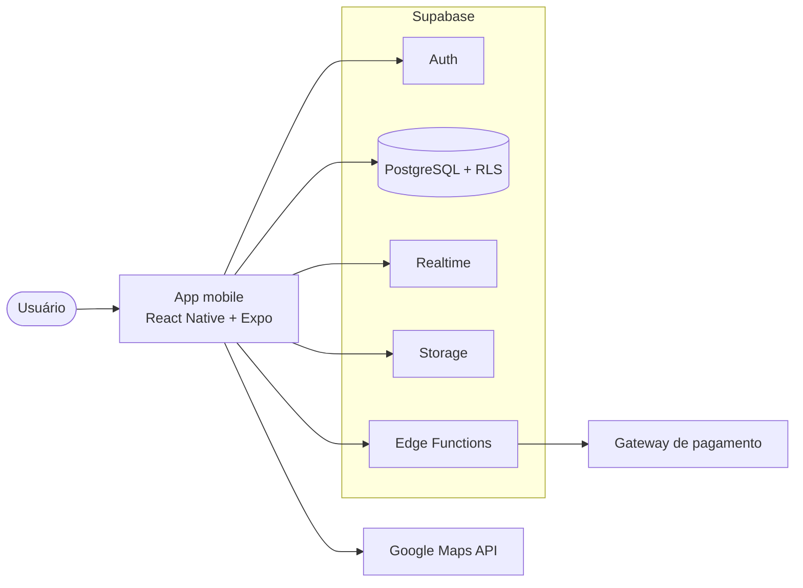

# Destrava

**Conectando professores de reforço escolar a pais próximos.**

> **Status:** MVP em desenvolvimento. Este repositório reúne o **aplicativo mobile** e o **backend no Supabase** do Destrava, além da documentação de planejamento ([apresentação](DESTRAVA.pdf) e [Business Model Canvas](DESTRAVA.png)). Por enquanto o app tem cadastro, login e perfil, e o banco já tem o schema de todas as funcionalidades do MVP; as telas da busca e das demais funcionalidades estão por vir.

## O que é

O Destrava é um aplicativo que aproxima pais que procuram reforço escolar para os filhos de professores particulares que atuam na mesma região. O pai encontra professores perto de casa, compara perfis e avaliações e pede contato pela plataforma. O professor ganha uma vitrine para divulgar seu trabalho e chegar a novos alunos.

## O problema

- **Para os pais:** é difícil encontrar um professor de reforço confiável e que more perto. A busca costuma depender de indicação boca a boca, sem como checar quem é a pessoa nem como ela trabalha.
- **Para os professores:** quem dá aula particular por conta própria tem dificuldade de se divulgar e de encontrar alunos na própria região.

## A proposta

O Destrava junta os dois lados numa plataforma só, com foco em **confiança e controle**:

- **Professores com identidade verificada**, por envio de documento no cadastro.
- **Busca por proximidade**, com filtros por matéria, idioma, valor e tipo de reforço.
- **Avaliações por estrelas**, com comentário opcional, deixadas por pais que já tiveram aula com o professor.
- **Contato mediado:** o pai envia uma solicitação e o professor decide se aceita ou recusa. Só depois do aceite os dois passam a ver o WhatsApp um do outro e o link da rede social do professor aparece. Isso dá mais privacidade e segurança aos dois lados. A conversa acontece no WhatsApp; não há chat dentro do app.

## Para quem é

- **Pais e responsáveis** por alunos do ensino fundamental e médio que buscam reforço escolar.
- **Professores particulares autônomos** que querem divulgar seus serviços e encontrar alunos na região.

## Como funciona

1. Qualquer pessoa, mesmo sem cadastro, navega pelos perfis dos professores próximos e vê nome, matérias, valor da hora e avaliações.
2. O pai cria uma conta e envia uma **solicitação de contato** por formulário, com seus dados, os dados do filho e o motivo do reforço.
3. O professor recebe a solicitação e **aceita ou recusa** em até 24 horas. Sem resposta, a solicitação expira e o pai pode pedir de novo.
4. Com o aceite, cada um ganha um **botão para abrir o WhatsApp** do outro e o **link da rede social** do professor passa a ficar visível para aquele pai.
5. Depois da aula, o pai **avalia** o professor com uma nota (obrigatória) e um comentário (opcional).

## Requisitos funcionais

| Código | O sistema deve                                                                                                                                                           |
| ------ | ------------------------------------------------------------------------------------------------------------------------------------------------------------------------ |
| RF01   | Permitir que professores criem uma conta e um perfil completo: dados pessoais, formação (opcional), matérias, idiomas, disponibilidade, tipo de reforço e valor da hora. |
| RF02   | Permitir a verificação de identidade do professor por envio de documento no cadastro.                                                                                    |
| RF03   | Permitir que qualquer usuário, mesmo sem cadastro, navegue e veja o perfil dos professores próximos (nome, matérias, valor e avaliações), exceto o link de rede social.  |
| RF04   | Permitir a busca de professores por proximidade geográfica (raio de distância ou cidade).                                                                                |
| RF05   | Permitir filtrar professores por matéria, idioma, valor e tipo de reforço.                                                                                               |
| RF06   | Exibir no perfil do professor a nota média e a quantidade total de avaliações recebidas.                                                                                 |
| RF07   | Permitir que o pai solicite contato com um professor por formulário (dados do responsável, do filho e motivo do reforço).                                                |
| RF08   | Permitir que o professor aceite ou recuse uma solicitação de contato recebida.                                                                                           |
| RF09   | Liberar o contato por WhatsApp entre pai e professor somente após o aceite da solicitação.                                                                               |
| RF10   | Permitir que pai e professor abram uma conversa no WhatsApp um com o outro, a partir do app, após o aceite.                                                              |
| RF11   | Liberar o link de rede social do professor somente após o aceite da solicitação.                                                                                         |
| RF12   | Permitir que o pai avalie o professor com nota (obrigatória) e comentário (opcional) após a aula.                                                                        |
| RF13   | Processar a cobrança da assinatura do professor, incluindo o controle do período de teste gratuito.                                                                      |
| RF14   | Exibir para o pai uma aba com todos os contatos já liberados.                                                                                                            |
| RF15   | Exibir para o professor uma aba com todas as solicitações e contatos recebidos.                                                                                          |

> **Mudanças em relação à apresentação:** o chat interno previsto originalmente (RF09, RF10, RF14 e RF15) foi substituído por um botão que abre o WhatsApp, liberado só depois do aceite. No MVP, a cobrança da assinatura (RF13) e a verificação de identidade (RF02) são **simuladas**: o fluxo funciona de ponta a ponta (teste grátis, cobrança mensal, cancelamento, aprovação do cadastro), mas nenhum pagamento real acontece e o documento é aprovado no envio.

## Requisitos não funcionais

| Código | O sistema deve                                                                     |
| ------ | ---------------------------------------------------------------------------------- |
| RNF01  | Responder às buscas em até 2 segundos.                                             |
| RNF02  | Garantir autenticação segura (senha criptografada e token).                        |
| RNF03  | Estar em conformidade com a LGPD.                                                  |
| RNF04  | Ser compatível com Android 8+ e iOS 13+.                                           |
| RNF05  | Garantir disponibilidade (uptime) de pelo menos 99%.                               |
| RNF06  | Permitir login e cadastro com conta Google (OAuth), além de e-mail e senha.        |
| RNF07  | Solicitar apenas as permissões estritamente necessárias, sempre com justificativa. |
| RNF08  | Ter tamanho de instalação inferior a 100 MB.                                       |
| RNF09  | Armazenar os dados com backup automático periódico.                                |
| RNF10  | Limitar o cache local a 200 MB, com opção de limpeza.                              |

## Arquitetura

O app mobile consome diretamente os serviços do Supabase, sem um backend próprio. As regras de negócio que não podem depender do app (aceite e recusa, liberação do WhatsApp e da rede social, cálculo de raio, controle de assinatura) ficam no próprio banco, em políticas de RLS (Row Level Security), triggers e funções. Edge Functions ficam para as integrações externas, como o gateway de pagamento quando ele for escolhido.



| Componente                     | Função                                                                                                        |
| ------------------------------ | ------------------------------------------------------------------------------------------------------------- |
| App mobile                     | Interface do usuário; consome diretamente os serviços do Supabase (auth, banco, realtime e storage).          |
| Supabase Auth                  | Autenticação de pais e professores, incluindo login com Google OAuth.                                         |
| Supabase Database (PostgreSQL) | Dados estruturados: perfis, solicitações de contato, avaliações e assinaturas. PostGIS para a busca por raio. |
| Supabase Realtime              | Notificações em tempo real (nova solicitação, aceite, avaliação).                                             |
| Supabase Storage               | Fotos de perfil (bucket público) e documentos de verificação dos professores (bucket privado).                |
| RLS, triggers e funções        | Regras de negócio: aceite e recusa, liberação do WhatsApp e da rede social, busca por raio e assinatura.      |
| Edge Functions                 | Integrações externas (gateway de pagamento, quando houver).                                                   |
| APIs externas                  | Mapas (geolocalização), WhatsApp (abertura da conversa por link) e gateway de pagamento.                      |

### Stack

| Camada                     | Tecnologia                                  |
| -------------------------- | ------------------------------------------- |
| Frontend mobile            | React Native com Expo (SDK 57) e TypeScript |
| Navegação                  | Expo Router                                 |
| Dados e formulários        | TanStack Query, react-hook-form e zod       |
| BaaS                       | Supabase                                    |
| Banco de dados             | PostgreSQL (via Supabase)                   |
| Autenticação               | Supabase Auth                               |
| Notificações em tempo real | Supabase Realtime                           |
| Busca geográfica           | PostGIS                                     |
| Jobs agendados             | pg_cron                                     |
| Armazenamento de arquivos  | Supabase Storage                            |
| Geolocalização             | Google Maps API                             |
| Infraestrutura             | Gerenciada pelo Supabase                    |

### Padrões de arquitetura

| Camada                  | Padrão                                                  |
| ----------------------- | ------------------------------------------------------- |
| Mobile                  | MVVM (Model-View-ViewModel) com organização por feature |
| Domínio (dentro do app) | Clean Architecture                                      |
| BaaS / Edge Functions   | Organização por domínio de negócio                      |

Como o app fala direto com o Supabase, a Clean Architecture é aplicada dentro do próprio app: as regras de negócio (liberar WhatsApp e rede social só após o aceite, calcular a proximidade) ficam isoladas das chamadas ao SDK do Supabase. Se o grupo trocar de provedor de BaaS no futuro, só a camada de integração precisa ser reescrita.

No MVP essa separação é aplicada de forma simplificada: cada feature concentra as chamadas ao Supabase num arquivo `api.ts`, os hooks da feature fazem o papel de ViewModel e as telas só renderizam.

### Implantação

O Destrava roda em nuvem, sobre o Supabase:

- **Sem infraestrutura própria:** não há servidores físicos nem backend dedicado para manter.
- **Custo inicial reduzido:** a camada gratuita do Supabase cobre as primeiras fases do produto.
- **Escalabilidade automática:** a infraestrutura acompanha o crescimento da base de usuários sem intervenção manual.

## Modelo de negócio


- **Receita:** assinatura mensal cobrada dos professores, com valor acessível e período de teste gratuito. Como evolução, está previsto um modelo freemium, com recursos pagos como maior destaque nos resultados de busca.
- **Canais:** Instagram, landing page otimizada para SEO, Play Store e App Store, parcerias com escolas e indicação boca a boca entre pais, alunos e professores.
- **Parcerias principais:** escolas (divulgação), gateway de pagamento, serviço de verificação de documentos, provedor de mapas e Supabase.
- **Custos:** desenvolvimento e manutenção do app, infraestrutura (Supabase), APIs de terceiros (mapas, verificação de identidade e pagamentos), marketing e aquisição de usuários, suporte, moderação e conformidade com a LGPD.

## Desenvolvimento

O repositório é um monorepo com npm workspaces: o app e o projeto Supabase (migrações, configuração e Edge Functions) são versionados juntos.

```
apps/mobile/   # app Expo (React Native + TypeScript)
supabase/      # config.toml, migrations/, functions/, seed.sql
```

### Pré-requisitos

- Node.js 24 (versão em `.nvmrc`)
- [Docker Desktop](https://www.docker.com/products/docker-desktop/) rodando, para o Supabase local
- O app **Expo Go** no celular, ou o navegador para a versão web

A Supabase CLI já vem como dependência do projeto; não precisa instalar à parte.

### Primeira execução

1. Instale as dependências na raiz:

   ```bash
   npm install
   ```

2. Suba o Supabase local. Na primeira vez ele baixa as imagens Docker, o que demora alguns minutos:

   ```bash
   npm run db:start
   ```

3. Crie o arquivo de ambiente do app a partir do modelo:

   ```bash
   cp apps/mobile/.env.example apps/mobile/.env
   ```

   Preencha `EXPO_PUBLIC_SUPABASE_PUBLISHABLE_KEY` com a chave "Publishable" mostrada por `npm run db:status`. Para abrir o app no celular, troque `127.0.0.1` em `EXPO_PUBLIC_SUPABASE_URL` pelo IP da sua máquina na rede Wi-Fi (o celular não enxerga o `127.0.0.1` do computador).

4. Inicie o app e leia o QR code com o Expo Go (ou aperte `w` para abrir no navegador):

   ```bash
   npm run mobile
   ```

O Supabase Studio local (painel do banco) fica em http://127.0.0.1:54323 enquanto o `db:start` estiver rodando.

### Scripts

| Comando                          | O que faz                                                  |
| -------------------------------- | ---------------------------------------------------------- |
| `npm run mobile`                 | Inicia o servidor do Expo                                  |
| `npm run lint`                   | ESLint no app                                              |
| `npm run typecheck`              | Checagem de tipos do TypeScript                            |
| `npm run format`                 | Formata o repositório com Prettier                         |
| `npm run db:start` / `db:stop`   | Liga e desliga o Supabase local                            |
| `npm run db:status`              | Mostra URLs e chaves locais                                |
| `npm run db:reset`               | Recria o banco local aplicando todas as migrações e o seed |
| `npm run db:migration -- <nome>` | Cria uma nova migração em `supabase/migrations/`           |
| `npm run db:types`               | Gera os tipos TypeScript do banco para o app               |
| `npm run db:push`                | Aplica as migrações no projeto Supabase remoto vinculado   |

### Banco de dados

O schema fica em `supabase/migrations/`, uma migração por domínio. Todas as tabelas têm RLS; as regras de acesso (o que o visitante vê, o que o aceite libera) valem no banco, não só na interface.

| Domínio             | Tabelas                                                                                      |
| ------------------- | -------------------------------------------------------------------------------------------- |
| Catálogo            | `subjects` (matérias), `languages` (idiomas)                                                 |
| Contas              | `profiles` (nome, foto, papel), `contact_details` (celular, liberado só após o aceite)       |
| Professores         | `teachers` (perfil público), `teacher_subjects`, `teacher_languages`, `teacher_social_links` |
| Verificação         | `teacher_verifications` (CPF e status), `teacher_documents` (arquivos no bucket privado)     |
| Assinatura          | `subscription_plans`, `subscriptions`, `subscription_payments` (cobranças simuladas)         |
| Responsáveis        | `students` (filhos), `student_subjects`, `favorite_teachers`                                 |
| Contato e avaliação | `contact_requests` (`pending` → `accepted`, `declined`, `expired` ou `cancelled`), `reviews` |
| Notificações        | `notifications` (geradas por triggers, entregues em tempo real)                              |

A busca é a função `search_teachers` (raio com PostGIS, cidade, texto, matéria, idioma, preço, tipo de aula e dias). Dois jobs do pg_cron rodam a cada 15 minutos: um encerra testes grátis e registra as mensalidades simuladas, o outro expira solicitações sem resposta em 24 horas.

### Mudando o banco

1. `npm run db:migration -- nome_da_mudanca` e escreva o SQL no arquivo criado. Toda tabela nova precisa de RLS.
2. `npm run db:reset` para aplicar do zero e conferir.
3. `npm run db:types` para atualizar `apps/mobile/src/lib/database.types.ts`.
4. Commite a migração e os tipos juntos.

### Projeto Supabase na nuvem

Quando o grupo criar o projeto no [painel do Supabase](https://supabase.com/dashboard), vincule e envie as migrações:

```bash
npx supabase login
```

```bash
npx supabase link --project-ref <id-do-projeto>
```

```bash
npm run db:push
```

No `.env` do app, use a URL e a chave publishable do projeto remoto. Lá a confirmação de e-mail vem ligada por padrão; o app já avisa o usuário para confirmar antes de entrar.

## Documentação

- [DESTRAVA.pdf](DESTRAVA.pdf): apresentação do projeto (ideia, requisitos, arquitetura, stack e padrões).
- [DESTRAVA.png](DESTRAVA.png): Business Model Canvas.

## Equipe

- Anna Beatriz Lima
- Ian Salomão
- Fátima Pinho
- Rebeca Batista
- Valeria Soares
